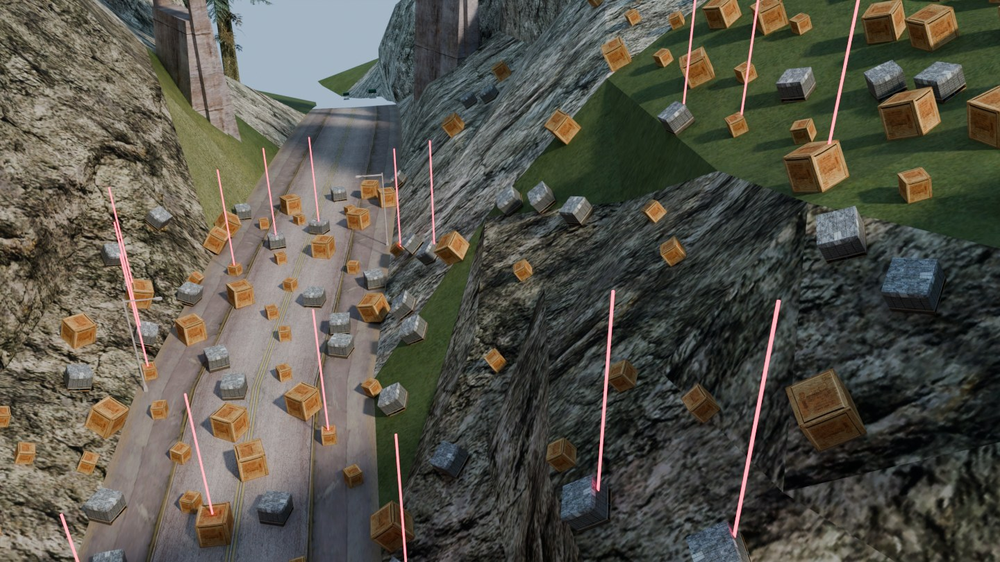
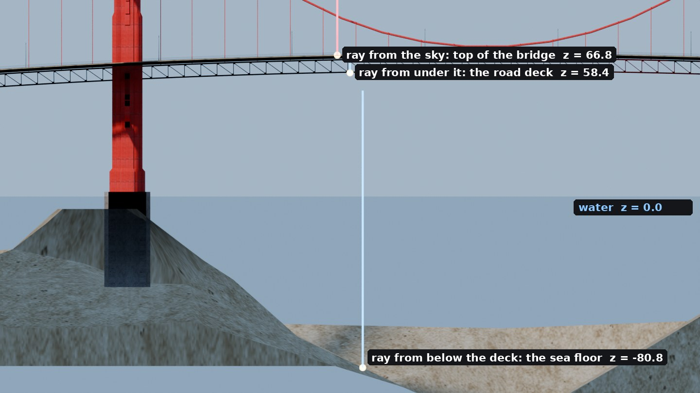
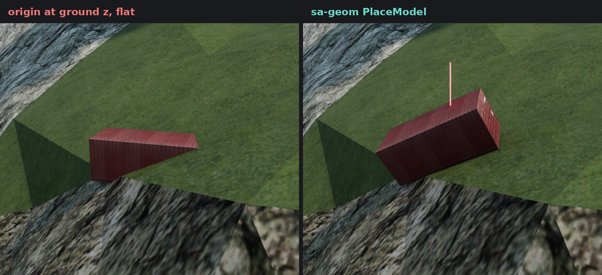
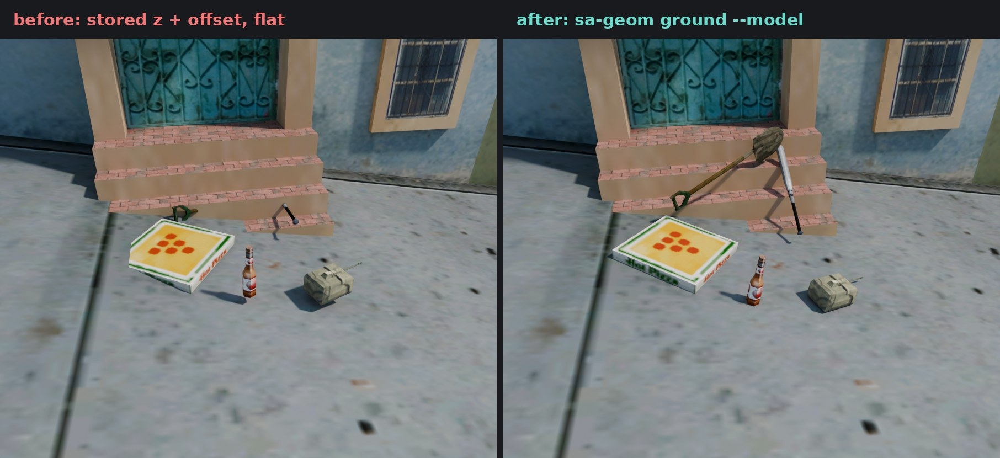
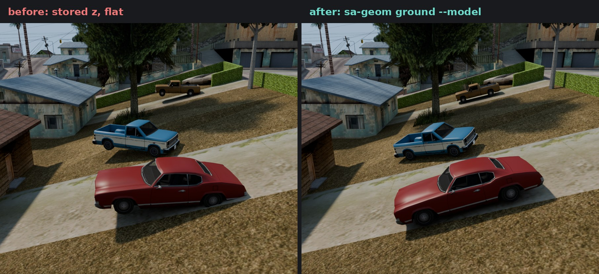

# sa-geom

**GTA San Andreas world collision for servers and tools: ground height, raycasts, surface normals and objects
placed flush on slopes, with no game client and no game files.**


<sub>204 crates dropped on a grid over a Vinewood hillside (25° average slope). Each one is a single
<code>sa-geom ground --model ID --yaw D</code> query, and the pink lines show some of the rays.</sub>

One Rust core, three ways to use it:

| | Target | What you get |
|---|---|---|
| **MTA:SA server module** | `ml_sageom.so` / `.dll` (x64, x86) | `sageomGround`, `sageomRaycast`, `sageomPlaceModel` and others in server-side Lua |
| **SA-MP / open.mp plugin** | `sageom.so` / `.dll` (x86) | `SAGeom_GetGround`, `SAGeom_RayCast`, `SAGeom_PlaceModel` and others in Pawn |
| **Command-line tool** | `sa-geom` (Linux, Windows, macOS) | One-off and batch queries as JSON or CSV, e.g. snapping a whole list of spawn points offline |

The full vanilla San Andreas collision world (7,760 collision models, 1.6 million triangles and 38,996
placements) is **built into every binary**, compressed to about 20 MB. Drop the module or plugin in and it works.
You don't need a `.hmap`, a `.cadb` or a copy of the game.

```lua
-- MTA, server side: a crate on the slope in front of the player, sitting on its base, facing where they face
local x, y, z, rx, ry, rz = sageomPlaceModel(1271, tx, ty, pz + 2, heading)
createObject(1271, x, y, z, rx, ry, rz)
```

```pawn
// SA-MP / open.mp: the same
new Float:z, Float:rx, Float:ry, Float:rz;
if (SAGeom_PlaceModel(1271, x, y, pz + 2.0, heading, z, rx, ry, rz))
    CreateObject(1271, x, y, z, rx, ry, rz);
```

```console
$ sa-geom ground -2300 -1700 --model 1271 --yaw 45
{ "hit": true, "z": 478.6807, "nx": 0.0042, "ny": -0.3217, "nz": 0.9468,
  "material": 123, "material_name": "P_DIRTROCKY", "model": 18319, "model_name": "cs_landbit_30",
  "pos": [-2299.9985, -1700.1125, 479.0121], "rot": [13.6764, 347.0258, 45.0], "water_z": null, ... }
```

## Why

- **MTA has no server-side world geometry.** `getGroundPosition` and `processLineOfSight` only exist on the
  client, so anything the server places has to wait for a player to come near and measure it. With sa-geom the
  server can place items, spawn points and props on the real ground itself.
- **MapAndreas** (SA-MP) is a 2D heightmap. It only gives the topmost height per grid cell, so it can't tell you
  about bridges, tunnels, floors or interiors, and it doesn't return a surface normal.
- **ColAndreas** (SA-MP/open.mp) does real collision with Bullet. It needs a generated `.cadb` database and doesn't
  exist for MTA.

sa-geom does real triangle raycasts (bridges, tunnels, several floors, interiors), returns the normal, the
surface material and the model hit, and turns all of that into the exact object rotation each server expects.


<sub>The Gant Bridge cut open at x = −2680. Three rays at the same spot, started at different heights, find
three different surfaces. A heightmap only ever knows the top one.</sub>

## Install

Download a release from [Releases](https://github.com/VIRUXE/sa-geom/releases), or [build from source](#building).

### MTA:SA

1. Copy the module into the server's modules folder: `x64/modules/ml_sageom.so` on Linux x64, `mods/deathmatch/modules/ml_sageom.so`
   on 32-bit Linux, or `x64\modules\ml_sageom.dll` / `mods\deathmatch\modules\ml_sageom.dll` on Windows.
2. Add it to `mods/deathmatch/mtaserver.conf`:
   ```xml
   <module src="ml_sageom.so"/>   <!-- ml_sageom.dll on Windows -->
   ```
3. Restart the server. The log shows `MODULE: Loaded "sa-geom"` and, about a second later,
   `[sa-geom] world loaded in ... ms`.

The functions are global in every resource. See [`examples/mta`](examples/mta) for a resource that drops
crates on slopes.

### SA-MP / open.mp

1. Copy `sageom.so` (Linux) or `sageom.dll` (Windows) into `plugins/`.
2. Load it. SA-MP: add `plugins sageom.so` to `server.cfg`. open.mp: add `"legacy_plugins": ["sageom"]` under `"pawn"` in
   `config.json`.
3. Copy [`include/sageom.inc`](include/sageom.inc) into your includes and `#include <sageom>`.

Both servers are 32-bit, and so is the plugin. See [`examples/samp`](examples/samp) for a filterscript.

### CLI

Put the `sa-geom` binary anywhere and run `sa-geom --help`.

## API

Coordinates are world metres. `interior` 0 is the outside world, and objects in area 13 are visible from every
interior. Pass -1 to see everything. `zFrom` is where the downward ray starts. It defaults to 1000, above
everything. Start it just above a point to find the floor under it instead of the roof above it. The world loads
in the background in about a second; until then every function returns `false`.

Placement rotations are the GTA object Euler angles that `createObject`/`setElementRotation` (MTA) and
`CreateObject`/`SetObjectRot` (SA-MP, open.mp) take. They were checked against MTA's `getElementMatrix` and
open.mp's quaternions. The object's up axis follows the surface normal, and its heading seen from above stays the
`yaw` you asked for (GTA convention: 0 faces north (+Y), 90 faces west).

### Lua (MTA, server side)

| Function | Returns |
|---|---|
| `sageomIsReady()` | `true` once the world is loaded |
| `sageomGround(x, y [, zFrom, interior, depth])` | `z, nx, ny, nz, material, model` or `false` |
| `sageomRaycast(x1, y1, z1, x2, y2, z2 [, interior])` | `true, x, y, z, nx, ny, nz, material, model` or `false` |
| `sageomPlace(x, y, zFrom, yaw [, lift, interior, width, depth])` | `x, y, z, rx, ry, rz, nx, ny, nz` or `false` |
| `sageomPlaceModel(model, x, y, zFrom, yaw [, lift, interior, restX, restY, restZ])` | `x, y, z, rx, ry, rz, nx, ny, nz` or `false` |
| `sageomGetModelBounds(model)` | `minX, minY, minZ, maxX, maxY, maxZ` or `false` |
| `sageomGroundMany({ {x, y [, zFrom]}, ... } [, interior])` | `{ {z, nx, ny, nz} or false, ... }` |
| `sageomWaterLevel(x, y)` | `z` or `false` |
| `sageomAddOverlay(path)` | `true, summary` or `false, error` (path relative to the server root) |

### Pawn (SA-MP, open.mp)

```pawn
native bool:SAGeom_IsReady();
native bool:SAGeom_GetGround(Float:x, Float:y, &Float:z, Float:zFrom = 1000.0, interior = 0,
    &Float:nx = 0.0, &Float:ny = 0.0, &Float:nz = 0.0, &material = 0, &model = 0);
native bool:SAGeom_RayCast(Float:x1, Float:y1, Float:z1, Float:x2, Float:y2, Float:z2,
    &Float:hx, &Float:hy, &Float:hz, interior = 0, &Float:nx = 0.0, &Float:ny = 0.0, &Float:nz = 0.0,
    &model = 0, &material = 0);
native bool:SAGeom_Place(Float:x, Float:y, Float:zFrom, Float:yaw, &Float:z, &Float:rx, &Float:ry, &Float:rz,
    Float:lift = 0.0, interior = 0, Float:width = 0.0, Float:depth = 0.0);
native bool:SAGeom_PlaceModel(modelid, Float:x, Float:y, Float:zFrom, Float:yaw, &Float:z, &Float:rx, &Float:ry,
    &Float:rz, Float:lift = 0.0, interior = 0, Float:restX = 0.0, Float:restY = 0.0, Float:restZ = 0.0);
native bool:SAGeom_GetModelBounds(modelid, &Float:minX, &Float:minY, &Float:minZ, &Float:maxX, &Float:maxY, &Float:maxZ);
native bool:SAGeom_WaterLevel(Float:x, Float:y, &Float:z);
native bool:SAGeom_AddOverlay(const path[]);   // relative to scriptfiles/
```

`SAGeom_GetGround(x, y, z)` replaces `MapAndreas_FindZ_For2DCoord(x, y, z)` directly.

### Placing things well


<sub>The same 3 × 7 m container (model 2934) on a 30° slope. Left: its origin at the ground height and no tilt,
as most scripts do it. Right: <code>PlaceModel</code>.</sub>

- **`*PlaceModel`** is usually what you want. It reads the model's shape, samples the ground under the corners
  of its base, tilts it to the plane through them, and lifts its origin by however far the origin sits above the
  model's lowest point. A long crate across a ridge or a dip rests on it instead of sinking in or floating, and
  models whose origin is mid-height don't end up half buried.
- **Shapes come from the render mesh.** Every model's `.dff` is baked into a small hull (26 extreme points), so
  models without collision (weapons, cans, ammo boxes, most pickups) and vehicles (whose collision is only the
  body: the wheels come from the mesh) land right too. Damaged parts, low-detail parts and muzzle flashes are
  left out. Models without a mesh fall back to their collision bounds.
- **Rest rotations.** Pass `restX, restY, restZ` (CLI `--rest RX,RY,RZ`) for a model that lies in a pose of its
  own before the heading, e.g. `90, 0, 0` for a rifle on its side. The lift is measured in that pose and the
  returned rotation includes it, so `createObject(model, x, y, z, rx, ry, rz)` is all it takes.
- **`*Place`** lays something on the ground under a single point. Give it `width`/`depth` for a footprint.
- **`*Ground`** gives you the raw height and normal to use however you like.
- `ground --model` also says whether the model fits: `blocked` names the first object reaching more than `--margin`
  (0.15 m) into its box in that pose (a wall, fence, pole, low roof; the bottom fifth is ignored so the ground,
  kerbs and wheels don't count), and `gap` is how far it is propped above the ground under its origin.
- `sa-geom model ID... [--rest RX,RY,RZ]` tells you what sa-geom knows about a model: its kind (object,
  weapon, vehicle), where its shape comes from, its size and how high its origin sits above its lowest point.

### CLI

```
sa-geom ground X Y [--from Z] [--yaw D] [--lift M] [--model ID [--rest RX,RY,RZ] | --footprint W,D] [--interior N]
sa-geom model  ID... [--rest RX,RY,RZ]                                   # kind, shape, size, origin height
sa-geom ray    X1 Y1 Z1 X2 Y2 Z2
sa-geom batch  [--format jsonl|csv] [--above M] < points
sa-geom info   [--at X Y Z --radius R]
sa-geom export --min X Y Z --max X Y Z [--origin X Y Z] -o region.obj   # collision as OBJ, grouped by surface
sa-geom placements --gta DIR --min X Y Z --max X Y Z [--margin M]      # every map placement in a box, as JSON
sa-geom bake   --gta DIR -o world.sagw.zst
```

Every command accepts `--overlay FILE` (repeatable), `--world FILE` (use another baked world) and `--gta DIR`
(build from a game install in memory, e.g. a modded one).

`batch` reads one query per line: JSON (`{"x":..,"y":..,"z":..,"yaw":..,"model":..,"rest":[rx,ry,rz],"w":..,"d":..,"interior":..}`,
where `z` is where the point is stored and the ray starts `--above` metres higher) or CSV (`x,y[,z[,yaw[,lift]]]`).
It writes one result per line. About 2,000 queries take 0.2 s after a 1 s load. In the output, `z` and the normal are the
surface that was hit, and `pos`/`rot` (CSV: x, y, z, rx, ry, rz) are where to create the object and how to turn it.

```console
$ printf '2495,-1687,13\n-2300,-1700\n' | sa-geom batch --format csv
x,y,z,nx,ny,nz,rx,ry,rz,material,model
2495.0,-1687.0,12.5204,-0.0032,0.0016,1.0,359.9105,359.8165,0.0,4,17613
-2300.0,-1700.0,478.6807,0.0041,-0.3217,0.9468,18.7641,0.2337,0.0,123,18319
```

## Fixing a spawn list

Most servers have hand-recorded spawn lists: loot points, vehicle spawns, pickups. They were stored at the height
of whoever recorded them, flat, for whatever model happened to be used. Each point then spawns many different
models, and each needs its own height and tilt: a lying rifle, an ammo box and a pickup truck on the same slope
don't share a z.

[`examples/spawn-points`](examples/spawn-points) fixes such a list offline in one pass. It takes the points and the
models each can spawn, and writes a placement for every point × model (× heading, for spawn systems that flip
cars), plus a report of the points that need a human: no ground under them, a wall or pole in the way, standing on
something the world doesn't have, under water, or too steep.

```console
$ python3 examples/spawn-points/fix_spawns.py vehicles.csv --models 400,422,461,468 --flip \
      --overlay mymaps.toml -o placements.jsonl --report check.csv
2017 points, 63669 placements, 145 points flagged
```

Loot scattered around a point (item *i* of *n* at angle *i*·360/*n*, a few tens of centimetres out) has a small,
fixed set of slots. `--scatter R --max N` measures each one, so items that roll off a table edge or down a step
can be pulled back in.





Leave the module for what only happens in game: a player dropping an item, a crate landing, a car being put back
on a road.

## Your own maps and models

The built-in world is vanilla San Andreas: every placement from the IPLs in `gta.dat` and their binary
streams. The script-only IPL groups (the story-mode bridge barriers, `crack`, `carter`, `truthsfarm`) are left
out, because multiplayer servers never load them. Anything you add goes in as an **overlay**:

- an MTA `.map` (`<object>`, `<removeWorldObject>`)
- a Pawn file (`CreateObject`, `CreateDynamicObject`, `RemoveBuildingForPlayer`)
- an `.ipl`, a `.col`, an `.ide`, a `.dff` or an `.img` (its `.col`s add collision, its `.dff`s add shapes)
- a [TOML manifest](examples/overlay.toml) that combines any of these, with wildcards

```lua
sageomAddOverlay("mods/deathmatch/resources/mymap/mymap.map")
```
```pawn
SAGeom_AddOverlay("maps/mymap.pwn");
```
```console
$ sa-geom ground 2495 -1687 --overlay mymaps.toml
```

Objects only collide if the world has collision for their model. Models you place by shape need a `.dff`
the world knows (in an `.img`, or loose `.dff` files listed in a manifest's `dff` entries). Vanilla models do. For SA-MP's added objects
(ids 18631 and up), add the SA-MP client's `SAMPCOL.img` and `SAMP.ide`. With those, 781 SA-MP models gain
collision. Do the same for custom models with their `.col` files.

## How it works

`sa-geom bake` reads `gta.dat`/`default.dat`, the IDEs (model id ↔ name), every COL1-COL4 collision archive
in `gta3.img`/`gta_int.img`, and the text and binary stream IPLs. LOD instances and models without
collision (plants, lights, litter) are skipped. Collision boxes become triangles, and spheres stay spheres.

Each model gets its own bounding volume hierarchy (SAH-binned) in model space. Each placement is a model plus an
affine transform. A second BVH over all placements finds the candidates a ray might hit, and each candidate is
tested in its own space. The result is the nearest hit along the segment, with the normal transformed back to
world space and facing the ray.

The whole thing is serialised to a flat versioned `.sagw` file, compressed with zstd and embedded with
`include_bytes!`. Rust's
pure-Rust zstd decoder unpacks it at load. In a server, loading runs on a background thread and queries take a
read lock, so the server's main thread never waits on a load.

Placement rotations go through the game's own quaternion convention, ported from open.mp's `GTAQuat`, so
`CreateObject` and MTA's `createObject` get exactly the orientation that was computed.

## Accuracy and limits

- **The world is collision, not visuals.** Collision meshes are close to what you see but simpler, which is what
  players walk on.
- **Dynamic objects are where the map puts them.** Breakable and movable objects (fences, bins, barrels) sit at
  their placed position. If one is knocked over in game, the server doesn't know.
- **Overlays are server-wide.** MTA dimensions and per-player SA-MP objects aren't tracked.
- **Bounds come from collision.** A model without collision has no bounds to place by.
- **The built-in world is the PC 1.0 map.** For a modded map, bake your own with `sa-geom bake --gta DIR` and point
  `--world` (CLI) or the `SAGEOM_WORLD` environment variable (module and plugin) at it.

## Renders

The images in this README are made by [`docs/render`](docs/render) from real sa-geom queries. The scenery and
the crates are the game's own models and textures, extracted with
[gta-scout](https://github.com/Dryxio/gta-scout) and DragonFF and rendered in Blender (Cycles), so they need a
local copy of the game:

```console
$ cargo build --release -p sa-geom-cli
$ GTA_SA="/path/to/GTA San Andreas" GTA_SCOUT=/path/to/gta-scout python3 docs/render/make.py [hero compare bridge] [--preview]
```

## Building

```console
$ cargo build --release                                              # CLI + MTA module for this machine
$ cargo build --release -p sa-geom-samp --target i686-unknown-linux-gnu  # SA-MP/open.mp plugin (needs gcc-multilib)
$ cargo test
```

`data/vanilla.sagw.zst` is committed. To regenerate it from your own copy of the game:

```console
$ cargo run --release -p sa-geom-cli -- bake --gta "/path/to/GTA San Andreas" -o data/vanilla.sagw.zst
```

Release builds come from [`.github/workflows/release.yml`](.github/workflows/release.yml). Linux binaries are
built against glibc 2.17 with `cargo-zigbuild`, so they run on old server distros.

| Crate | What |
|---|---|
| `sa-formats` | Parsers: IMG v2, gta.dat, IDE, IPL (text + binary), COL1-4, water.dat, MTA `.map`, Pawn |
| `sa-world` | The world: BVHs, queries, placement, overlays, `.sagw` files, the embedded data |
| `sa-geom-cli` | The `sa-geom` command |
| `sa-geom-mta` | The MTA module |
| `sa-geom-samp` | The SA-MP / open.mp plugin |

## License

The code is released into the public domain under [the Unlicense](LICENSE).

`data/vanilla.sagw.zst` is collision data derived from Grand Theft Auto: San Andreas, © Rockstar Games. It
is included so the tools work without a game install, in the same spirit as MapAndreas' heightmap. It is not
covered by the Unlicense, and you should own the game to use it.
